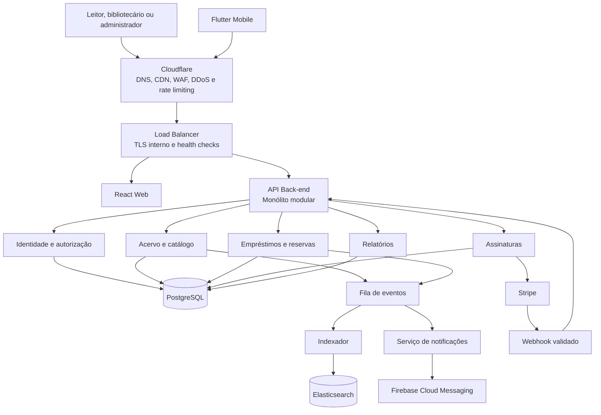

# Documento de Arquitetura de Software — SaaS de Gerenciamento de Bibliotecas

Disciplina: Desenvolvimento de Software Corporativo
Curso: Engenharia de Software
Semestre: 2026-02
Professor: Lucas Santos da Silva
Material complementar: Aula 2 — Fundamentos de Design e Arquitetura de Software

## 1. Resumo do funcionamento do sistema

O sistema é um **SaaS** (*Software as a Service*, ou software fornecido como serviço) para gerenciamento de bibliotecas. Cada biblioteca contratante possui seu próprio ambiente lógico, com catálogo, exemplares, leitores, empréstimos, reservas, configurações e usuários administrativos.

Um bibliotecário pode cadastrar uma obra, registrar os exemplares físicos disponíveis e controlar empréstimos e devoluções. Um leitor pode consultar o catálogo, reservar uma obra indisponível e receber notificações quando houver uma cópia disponível ou quando o prazo de devolução estiver próximo. Já o administrador da biblioteca gerencia usuários, regras de empréstimo e assinatura do serviço.

O sistema será disponibilizado por aplicações web e mobile. As requisições passam pela Cloudflare, responsável pela proteção de borda, e depois por um Load Balancer, que distribui o tráfego entre instâncias saudáveis do back-end. O banco de dados relacional mantém os dados transacionais; o Elasticsearch oferece busca rápida no catálogo; uma fila desacopla tarefas demoradas; o Firebase Cloud Messaging envia notificações push; e o Stripe controla a assinatura do SaaS pelas bibliotecas.

O estilo arquitetural recomendado para a primeira versão é um **monólito modular**: uma única aplicação de back-end, mas organizada por domínios de negócio bem definidos. Isso reduz a complexidade operacional inicial sem impedir uma futura extração de componentes, como notificações ou busca.

## 2. Requisitos funcionais

Os requisitos funcionais descrevem o que o sistema deve permitir que seus usuários façam. Eles orientam os módulos, endpoints e regras de negócio descritos nas seções seguintes.

| ID | Requisito funcional | Descrição |
|---|---|---|
| RF01 | Gerenciar bibliotecas clientes | A plataforma deve permitir cadastrar e administrar bibliotecas contratantes, com plano, configurações e limites próprios. |
| RF02 | Autenticar e autorizar usuários | O sistema deve permitir login, recuperação de senha, controle de sessão e acesso conforme o perfil do usuário. |
| RF03 | Gerenciar perfis | O sistema deve diferenciar administrador da plataforma, administrador da biblioteca, bibliotecário e leitor. |
| RF04 | Manter acervo | Bibliotecários devem cadastrar, consultar, atualizar e arquivar obras, autores, editoras e categorias. |
| RF05 | Controlar exemplares | O sistema deve registrar cada cópia física, sua localização, estado de conservação e situação de disponibilidade. |
| RF06 | Pesquisar catálogo | Leitores e equipe da biblioteca devem pesquisar por título, autor, ISBN, categoria e disponibilidade. |
| RF07 | Gerenciar leitores | A biblioteca deve cadastrar, atualizar, bloquear e consultar leitores e seu histórico. |
| RF08 | Realizar empréstimos | Bibliotecários devem registrar empréstimos após validar disponibilidade, limite de itens e situação do leitor. |
| RF09 | Registrar devoluções | O sistema deve registrar devoluções, calcular atraso, liberar o exemplar ou separá-lo para reserva pendente. |
| RF10 | Permitir renovações | O sistema deve permitir renovar um empréstimo quando as regras da biblioteca permitirem e não houver reserva pendente. |
| RF11 | Gerenciar multas e pendências | A equipe deve consultar, ajustar, isentar ou registrar pagamento de multas com justificativa auditável. |
| RF12 | Gerenciar reservas | Leitores devem criar e cancelar reservas; o sistema deve manter a fila de espera e a posição de cada leitor. |
| RF13 | Notificar usuários | O sistema deve enviar avisos de vencimento, atraso, reserva disponível e comunicados por notificações push. |
| RF14 | Exibir área do leitor | O leitor deve consultar seus empréstimos atuais, histórico, reservas e notificações. |
| RF15 | Gerar relatórios | Administradores e bibliotecários devem acessar relatórios de circulação, atrasos, leitores ativos e obras mais emprestadas. |
| RF16 | Registrar auditoria | O sistema deve manter registro de ações relevantes, incluindo quem realizou a ação, quando e em qual biblioteca. |
| RF17 | Gerenciar assinatura SaaS | Administradores da biblioteca devem consultar plano, iniciar checkout, acessar faturamento e acompanhar o estado da assinatura. |
| RF18 | Isolar dados por biblioteca | Todas as operações devem garantir que uma biblioteca consulte e altere apenas seus próprios dados. |

## 3. Requisitos não funcionais

Os requisitos não funcionais definem as características de qualidade, segurança e operação esperadas para a solução. Eles não representam uma tela ou operação isolada, mas influenciam todas as decisões arquiteturais.

| ID | Requisito não funcional | Critério esperado | Solução arquitetural associada |
|---|---|---|---|
| RNF01 | Segurança | Acesso externo protegido, comunicação criptografada, credenciais protegidas e permissões aplicadas por perfil. | Cloudflare com WAF e proteção DDoS, HTTPS, tokens de acesso, hash de senha, controle de acesso e cofre de segredos. |
| RNF02 | Isolamento multi-tenant | Uma biblioteca não pode consultar, alterar ou receber dados de outra. | Contexto obrigatório de `biblioteca_id`, filtros de autorização, índices compostos e evolução possível para *row-level security*. |
| RNF03 | Disponibilidade | O sistema deve continuar acessível quando uma instância da API falhar. | Load Balancer, múltiplas instâncias da API, *health checks* e remoção de instâncias não saudáveis. |
| RNF04 | Escalabilidade | A solução deve suportar crescimento de usuários, acervo e requisições sem reescrita completa. | API sem estado para permitir escala horizontal, Load Balancer, cache, Elasticsearch e processamento assíncrono. |
| RNF05 | Desempenho | Consultas ao catálogo e entrega de conteúdo estático devem responder rapidamente. | Elasticsearch para busca e filtros, CDN da Cloudflare para conteúdo estático e cache para leituras frequentes. |
| RNF06 | Confiabilidade e integridade transacional | Empréstimos, devoluções e reservas não podem deixar dados em estado inconsistente. | PostgreSQL como fonte oficial, transações para alterações críticas e regras de status do exemplar. |
| RNF07 | Resiliência de integrações | Falhas temporárias no Firebase, Elasticsearch ou Stripe não devem interromper operações principais. | Fila de eventos, retentativas controladas, processamento assíncrono e armazenamento da operação principal antes da integração externa. |
| RNF08 | Observabilidade | A equipe deve identificar, diagnosticar e responder a falhas em produção. | Logs estruturados, métricas, rastreamento de erros, alertas e identificador de requisição. |
| RNF09 | Auditabilidade | Ações administrativas e alterações relevantes devem poder ser rastreadas. | Trilha de auditoria com usuário, biblioteca, data, origem, ação e resultado. |
| RNF10 | Manutenibilidade | O sistema deve ser compreensível, testável e seguro para evoluir. | Monólito modular, separação por domínios, contratos de eventos e testes para regras de negócio. |
| RNF11 | Privacidade e proteção de dados | Dados pessoais devem ser acessados somente quando necessários e armazenados com proteção adequada. | Princípio do menor privilégio, controle de acesso, retenção adequada, segredos fora do código e minimização de dados. |
| RNF12 | Idempotência de eventos | Um mesmo evento externo não pode duplicar cobranças, ativações ou alterações internas. | Validação da assinatura do Stripe, registro do identificador do evento e processamento idempotente de webhooks. |

## 4. Visão geral da arquitetura

## 5. Componentes e responsabilidades

| Componente | Responsabilidades principais |
|---|---|
| Cloudflare | DNS, certificado HTTPS, CDN para arquivos estáticos, WAF, proteção contra DDoS e limitação de requisições por IP e rota. |
| Load Balancer | Distribuir requisições entre instâncias da API, executar *health checks* e retirar instâncias não saudáveis do tráfego. |
| React Web | Portal administrativo e catálogo web responsivo para bibliotecários, administradores e leitores. |
| Flutter Mobile | Aplicativo para leitores e, opcionalmente, bibliotecários: consulta, reservas, carteira de empréstimos e notificações push. |
| API Back-end | Expor endpoints REST, autenticar usuários, aplicar regras de negócio e coordenar persistência e integrações. |
| Identidade e autorização | Login, renovação de token, recuperação de senha, perfis, permissões e garantia de acesso apenas ao tenant correto. |
| Acervo | Obras, autores, categorias, editoras, exemplares, localização física e disponibilidade. |
| Empréstimos e reservas | Retirada, devolução, renovação, bloqueios, multas, fila de reservas e cálculo de prazos. |
| Assinaturas | Planos, limites, estado da assinatura e integração de cobrança com Stripe. |
| PostgreSQL | Fonte oficial dos dados transacionais e relacionamentos do domínio. |
| Elasticsearch | Índice de leitura para busca textual, filtros e ordenação do catálogo; não é a fonte oficial dos dados. |
| Fila de eventos | Executar tarefas assíncronas: indexação, envio de notificações, relatórios e processamento de webhooks. |
| Firebase Cloud Messaging | Entregar notificações push a aplicativos Flutter e navegadores autorizados. |
| Stripe | Checkout, assinaturas recorrentes, faturamento e emissão de eventos de pagamento via webhook. |
| Observabilidade | Logs estruturados, métricas, rastreamento de erros, auditoria e alertas operacionais. |

## 6. Princípios e decisões arquiteturais

### 6.1 Multi-tenancy e isolamento de dados

Cada biblioteca é um **tenant**. Toda entidade de negócio relevante deve estar ligada a uma `biblioteca_id`, direta ou indiretamente. A API extrai a biblioteca do usuário autenticado e aplica esse contexto em todas as consultas e comandos. Um identificador enviado pelo cliente nunca deve ser suficiente para trocar de tenant.

Na primeira versão, o isolamento será feito no mesmo banco com coluna `biblioteca_id`, índices compostos e políticas na camada de aplicação. Para clientes com exigências maiores, a evolução pode incluir *row-level security* no PostgreSQL ou banco por tenant.

### 6.2 Perfis de acesso

| Perfil | Capacidades principais |
|---|---|
| Administrador da plataforma | Gerencia bibliotecas contratantes, planos e suporte operacional. |
| Administrador da biblioteca | Gerencia usuários internos, regras, catálogo e assinatura da própria biblioteca. |
| Bibliotecário | Opera acervo, exemplares, empréstimos, devoluções e reservas. |
| Leitor | Consulta catálogo, gerencia próprio perfil, empréstimos e reservas. |

### 6.3 Persistência, busca e eventos

Uma alteração em obra, exemplar, empréstimo ou reserva é gravada primeiro no PostgreSQL dentro de uma transação. Após a confirmação, é publicado um evento, como `obra.atualizada` ou `emprestimo.vencimento_proximo`. Consumidores assíncronos atualizam o Elasticsearch ou enviam a notificação correspondente. Assim, uma falha temporária no FCM ou no Elasticsearch não impede uma devolução de livro.

### 6.4 Segurança e disponibilidade

- Todo tráfego externo usa HTTPS; a origem da API aceita tráfego apenas da Cloudflare e do Load Balancer.
- A Cloudflare aplica regras de WAF e *rate limiting*, especialmente em login, recuperação de senha e busca pública.
- Tokens de acesso têm expiração curta; *refresh tokens* são revogáveis e armazenados de modo seguro.
- Senhas são armazenadas apenas como hash forte, nunca em texto puro.
- Dados sensíveis, como chaves do Stripe e Firebase, ficam em cofre de segredos e não no repositório.
- Backups automáticos, restauração testada e alertas de indisponibilidade são requisitos operacionais.

## 7. Front-end

### 7.1 Aplicação web com React

O React será a tecnologia principal do portal web. Ele atenderá principalmente administradores e bibliotecários, que precisam de telas ricas de cadastro, tabelas, filtros, relatórios e operações rápidas de balcão. O catálogo também poderá ser acessado pelo navegador.

Responsabilidades do React:

- Exibir páginas de login, catálogo, acervo, leitores, empréstimos, reservas, relatórios e assinatura.
- Consumir a API REST com token de acesso.
- Validar experiência de formulário e apresentar erros da API, sem concentrar regras de negócio críticas no navegador.
- Controlar rotas e visibilidade de menus conforme o perfil do usuário.
- Registrar o dispositivo no FCM quando o navegador aceitar notificações push.

### 7.2 Aplicativo mobile com Flutter

O Flutter será a tecnologia principal do aplicativo mobile para Android e iOS. Seu foco inicial é o leitor: catálogo, busca, detalhes de obras, reservas, empréstimos em andamento, histórico e notificações. Uma área simplificada para bibliotecário pode ser adicionada depois, por exemplo para consulta de leitor e leitura de código de barras.

Responsabilidades do Flutter:

- Autenticar o usuário e armazenar tokens em armazenamento seguro do dispositivo.
- Consultar catálogo e disponibilidade em tempo real pela API.
- Criar e cancelar reservas do próprio leitor.
- Exibir prazos, atrasos e situação dos empréstimos.
- Integrar o SDK do Firebase para obter o token de dispositivo e receber notificações push.
- Oferecer navegação adaptada ao contexto mobile e tratamento de conectividade limitada.

## 8. Convenções da API

- Base da API: `/api/v1`.
- Formato: JSON em UTF-8.
- Autenticação: `Authorization: Bearer <access_token>` nas rotas protegidas.
- Paginação: `page`, `per_page`, `total` e `total_pages`.
- Datas: ISO 8601 em UTC, por exemplo `2026-08-12T14:30:00Z`.
- Identificadores: UUID.
- Erros: `{ "code": "LIVRO_INDISPONIVEL", "message": "Não há exemplar disponível." }`.
- Ações administrativas registram usuário, tenant, data, origem e resultado na auditoria.
